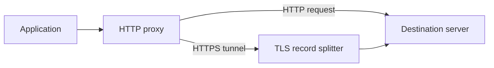

# Architecture

`dpi-proxy` is an HTTP forward proxy. It forwards ordinary HTTP requests and opens byte-stream tunnels for HTTPS `CONNECT` requests. For eligible TLS connections it changes how the first TLS record is sent, without decrypting the connection.

The request path depends on whether the application sends HTTP or opens a tunnel.

## Components

- **Listener:** accepts connections and limits concurrent clients to 512.
- **HTTP proxy:** validates requests, connects to their destination, and forwards one ordinary HTTP request per connection.
- **TLS splitter:** splits an eligible ClientHello after the first byte of its server name; otherwise it forwards the stream unchanged.
- **Retry:** can reconnect once without splitting if the initial TLS exchange fails before replay becomes unsafe.

## Invariants

- Ordinary HTTP requests are never replayed, avoiding duplicate uploads or purchases.
- The proxy does not authenticate clients or encrypt their connection to the proxy. HTTPS remains encrypted between the application and destination.
- Once additional client data has been forwarded, the initial TLS message is not retried.
